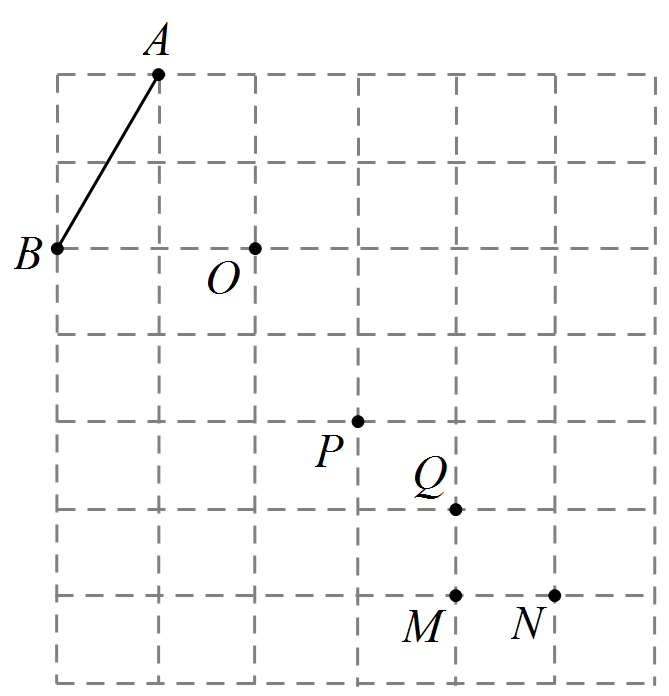

# Mathematics - 题目 2803

**ID**: d6c309b073f9441b8d0901ff58471d5c
**年级**: Grade 9
**难度**: Medium
**题型**: Multiple-choice

## 题目
在如图所示正方形网格图中，以O为位似中心，把线段 $AB$ 放大为原来的2倍，则A的对应点为（      ）​​​​​​​‌

## 解答

1. 解：如图，
2. 
3. 以O为位似中心，把线段AB放大为原来的2倍，根据位似的性质，则点A到点O的距离和点A的对应点到点O的距离的比是1：2，
4. 故点A的对应点是M点．
5. 故选B．

## 知识点

**中文**:
  - 坐标系与位似图形

**English**:
  - Coordinates and Homothetic Figures

---
