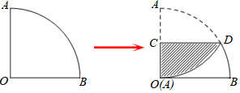

# Mathematics - 题目 3847

**ID**: d7b1a8af8dca4b4eb82014aca5d03e2c
**年级**: Grade 9
**难度**: Medium
**题型**: Multiple-choice

## 题目
如图1，一个扇形纸片的圆心角为90°，半径为6．如图2，将这张扇形纸片折叠，使点A与点O恰好重合，折痕为CD，图中阴影为重合部分，则阴影部分的面积为（      ）​​​​​​​‌

## 解答

1. 解：连接OD，如图，
2. 
3. ∵扇形纸片折叠，使点A与点O恰好重合，折痕为CD，
4. ∴AC＝OC，
5. ∴OD＝2OC＝6，
6. ∴CD＝ $\sqrt {6{^{2}}-3{^{2}}}=3\sqrt {3}$ ，
7. ∴∠CDO＝30°，∠COD＝60°，
8. ∴由弧AD、线段AC和CD所围成的图形的面积＝S_{扇形}_{AOD}﹣S_{△}_{COD}
9. ＝ $\frac {60\cdot π\cdot 6{^{2}}}{360}$ ﹣ $\frac {1}{2}\cdot 3\cdot 3\sqrt {3}$
10. ＝6π﹣ $\frac {9\sqrt {3}}{2}$ ，
11. ∴阴影部分的面积为6π﹣ $\frac {9\sqrt {3}}{2}$ .
12. 故选A．

## 知识点

**中文**:
  - 勾股定理的应用
  - 扇形面积的计算

**English**:
  - Applications of Pythagorean Theorem
  - Sector Area Calculation

---
