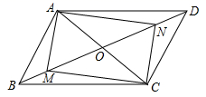

# Mathematics - 题目 1999

**ID**: dd55d6dea1a547f196f03544d59d70f0
**年级**: Grade 9
**难度**: Medium
**题型**: Multiple-choice

## 题目
如图，在平行四边形 $ABCD$ 中，M、N是 $BD$ 上两点， $BM=DN$ ，连接 $AM$ 、 $MC$ 、 $CN$ 、 $NA$ ，添加一个条件，使四边形 $AMCN$ 是矩形，这个条件是（      ）​​​​​​​‌

## 解答

1. 证明：∵四边形ABCD是平行四边形，
2. ∴OA=OC，OB=OD
3. ∵对角线BD上的两点M、N满足BM=DN，
4. ∴OB-BM=OD-DN，即OM=ON，
5. ∴四边形AMCN是平行四边形，
6. ∵2OM=AC，
7. ∴MN=AC，
8. ∴四边形AMCN是矩形．
9. 故选：D．

## 知识点

**中文**:
  - 平行线的判定与性质
  - 矩形的判定

**English**:
  - Determination and Properties
  - Determination of Rectangles

---
