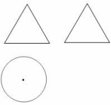

# Mathematics - 题目 1829

**ID**: de566efdba8d42058e567a267b3ca899
**年级**: Grade 9
**难度**: Medium
**题型**: Multiple-choice

## 题目
如图，一个空间几何体的主视图和左视图都是边长为1的三角形，俯视图是一个圆，那么这个几何体的侧面积是（      ）​​​​​​​‌

## 解答

1. 解：综合主视图，俯视图，左视图可以看出这个几何体应该是圆锥，且底面圆的半径为 $\frac {1}{2}$ ，母线长为1，
2. 因此侧面面积为 $\frac {1}{2}$ ×π×1＝ $\frac {1}{2}$ π.
3. 故本题答案为：D.

## 知识点

**中文**:
  - 三视图的相关计算

**English**:
  - Calculations with Three Views

---
