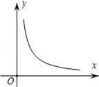

# Mathematics - 题目 869

**ID**: e3f1ef9fa7d145e8b9677df41b016130
**年级**: Grade 9
**难度**: Medium
**题型**: Multiple-choice

## 题目
设函数y= $\frac {k}{x}$ （k≠0，x＞0）的图象如图所示，若z= $\frac {1}{y}$ ，则z关于x的函数图象可能为（      ）​​​​​​​‌

## 解答

1. ∵y= $\frac {k}{x}$ （k≠0，x＞0），
2. ∴z= $\frac {1}{y}=\frac {1}{\frac {k}{x}}$  = $\frac {x}{k}$ （k≠0，x＞0）
3. ∵反比例函数y= $\frac {k}{x}$ （k≠0，x＞0）的图象在第一象限，
4. ∴k＞0，
5. ∴ $\frac {1}{k}$ ＞0．
6. ∴z关于x的函数图象为第一象限内，且不包括原点的正比例的函数图象．

## 知识点

**中文**:
  - 反比例函数的图象
  - 反比例函数的性质

**English**:
  - Graph of Inverse Proportionality Functions
  - Properties of Inverse Proportionality Functions

---
