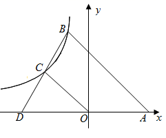

# Mathematics - 题目 1876

**ID**: e7b57d5135eb4049bbbeef07c57911eb
**年级**: Grade 9
**难度**: Medium
**题型**: Multiple-choice

## 题目
如图，在 $x$ 轴上有一点 $A\left ({3,0}\right )$ ，点 $D$ 是点 $A$ 关于 $y$ 轴的对称点，点 $B$ 在反比例函数 $y=\frac {k}{x}\left ({x<0}\right )$ 的图像上，连接 $BD$ ，交反比例函数图象于点 $C$ ，若 $OC//AB$ ， $S{{}_{△ABD}}=24$ ．则 $k=$ （      ）​​​​​​​‌

## 解答

1. 
2. 过B、C点作x轴的垂线，分别交于E、F，
3. ∵D为A点关于y轴的对称点，
4. ∴D为（-3,0），
5. ∴AD=6
6. ∵S_{△}_{ADB}=BE×AD÷2=24，
7. ∴BE=8，
8. ∵OC${\rm{/}}{\rm{/}}$AB，
9. ∴△DCO∽△DBA，
10. ∴ $\frac {OC}{AB}=\frac {DO}{AD}=\frac {1}{2}$ ，
11. ∵△OCF∽△ABE，
12. ∴ $\frac {CF}{BE}=\frac {OC}{AB}=\frac {OF}{AE}=\frac {1}{2}$ ，
13. ∴CF=4，
14. ∴B为 $\left ({\frac {k}{8}，8}\right )$ ，C为 $\left ({\frac {k}{4}，4}\right )$ ，
15. ∵AE= $3-\frac {k}{8}$ ，OF= $-\frac {k}{4}$ ，
16. ∴ $3-\frac {k}{8}$ = $-\frac {k}{4}$ ×2
17. 解得k=-8，
18. 故选：C．

## 知识点

**中文**:
  - 反比例函数的图象和性质
  - 相似三角形的性质

**English**:
  - Graphs and Properties of Inverse Proportionality
  - Properties of Similar Triangles

---
