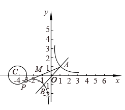

# Mathematics - 题目 2511

**ID**: ea4f2107d4c741feac182ac276be8dca
**年级**: Grade 9
**难度**: Medium
**题型**: Multiple-choice

## 题目
如图，在平面直角坐标系中，直线 $y=x$ 与双曲线 $y=\frac {1}{x}$ 交于A、B两点，P是以点 $C\left ({-4,0}\right )$ 为圆心，半径长为1的圆上一动点，连接AP，M为AP的中点．则线段OM长度最大值为（      ）​​​​​​​‌

## 解答

1. 连接BP，OM
2. 
3. $\because $M为AP的中点，O为AB的中点，
4. $\therefore OM$ 为 $△ABP$ 的中位线，
5. $\therefore OM=\frac {1}{2}BP$ ．
6. 当点P为BC延长线与⊙C交点时BP最大，即OM最大，
7. $\because $ 直线 $y=x$ 与双曲线 $y=\frac {1}{x}$ 交于A、B两点，
8. $\therefore x=\frac {1}{x}$ ，
9. 解得 $x=\pm 1$ ，
10. $\therefore B(-1,-1)$ ．
11. $\because C\left ({-4,0}\right )$ ，
12. $\therefore BC=\sqrt {(-4+1){^{2}}+(-1){^{2}}}=\sqrt {10}$ ，
13. $\because $ 圆的半径为1，
14. $\therefore BP=\sqrt {10}+1$ ，
15. $\therefore OM=\frac {\sqrt {10}+1}{2}$ ，
16. 故选：D．

## 知识点

**中文**:
  - 一次函数的图象和性质
  - 两点间的距离公式
  - 反比例函数综合
  - 三角形中位线

**English**:
  - Graphs and Properties of Linear Functions
  - Distance Formula
  - Comprehensive Inverse Proportionality Problems
  - Triangle Midsegment

---
