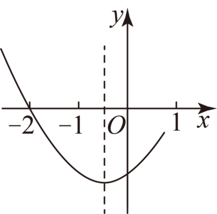

# Mathematics - 题目 1195

**ID**: ed064051f8ab4eef8549926e0a8c28ab
**年级**: Grade 9
**难度**: Medium
**题型**: Multiple-choice

## 题目
二次函数y＝ax^{2}+bx+c（a≠0）的部分图象如图所示，其对称轴为直线x＝﹣ $\frac {1}{2}$ ，且与x轴的一个交点坐标为（﹣2，0）．下列结论：①abc＞0；​​​​​​​‌②a＝b；③2a+c＝0；④关于x的一元二次方程ax^{2}+bx+c﹣1＝0有两个相等的实数根．其中正确结论的序号是（      ）

## 解答

1. 解：①由图可知： ${\rm \mathit{a}＞0，\mathit{c}＜0，}-\frac {b}{2a}{\rm ＜0}$ ，
2. ∴b＞0，
3. ∴abc＜0，故①不符合题意．
4. ②由题意可知： $-\frac {b}{2a}{\rm ＝}$  $-\frac {1}{2}$ ，
5. ∴b＝a，故②符合题意．
6. ③将（﹣2，0）代入y＝ax^{2}+bx+c，
7. ∴4a﹣2b+c＝0，
8. ∵a＝b，
9. ∴2a+c＝0，故③符合题意．
10. ④由图象可知：二次函数y＝ax^{2}+bx+c的最小值小于0，
11. 令y＝1代入y＝ax^{2}+bx+c，
12. ∴ax^{2}+bx+c＝1有两个不相同的解，故④不符合题意．
13. 故选D．

## 知识点

**中文**:
  - 二次函数的图象与系数之间的关系

**English**:
  - Relationship between Graphs and Coefficients

---
