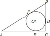

# Mathematics - 题目 703

**ID**: f0beb91c922a40ceafdd4c56a47a8f18
**年级**: Grade 9
**难度**: Medium
**题型**: Multiple-choice

## 题目
在△ABC中，已知∠C=90°，BC=3，AC=4，则它的内切圆半径是（      ）​​​​​​​‌

## 解答

1. 连接OD，OE，得四边形ODCE为正方形，设CE=CD=r，则BD=3-r=BF,AE=AF=4-r,根据勾股定理得AB=5，则得方程 $3-r+4-r=5\Rightarrow r=1$  .故选B.
2. 
3. 本题目是一道关于圆的切线题目，主要运用切线长定理，解决问题，还运用了勾股定理，难度不大.切线长定理，从圆外一点所画的两条圆的切线长相等.根据这个定理列出方程求解内切圆的半径.

## 知识点

**中文**:
  - 三角形内切圆
  - 切线长定理

**English**:
  - Incircle of Triangle
  - Tangent Length Theorem

---
