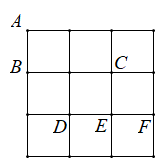

# Mathematics - 题目 2303

**ID**: f210113f131a4b57bdff63b3ebdacc40
**年级**: Grade 9
**难度**: Medium
**题型**: Multiple-choice

## 题目
在如图所示的3×3方格纸中，点A、B、C、D、E、F均为小正方形的顶点．先从A、B、C中任意取两点，再从D、E、F中任取一点画三角形，则所画三角形是直角三角形的概率是（      ）​​​​​​​‌

## 解答

1. 解：先从A、B、C中任意取两点，再从D、E、F中任取一点画三角形共有 $3\times 3=9$ 种等可能的结果，其中只有取B、C、D或B、C、E两种情况可以构成直角三角形，因此构成直角三角形的概率为 $\frac {2}{9}$ ，故C正确．
2. 故选：C．

## 知识点

**中文**:
  - 概率的应用

**English**:
  - Applications of Probability

---
