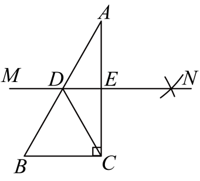

# Mathematics - 题目 2377

**ID**: f500b30ed75a4777bca39e47fae13bbd
**年级**: Grade 9
**难度**: Medium
**题型**: Multiple-choice

## 题目
如图，在 ${\rm{R}}{\rm{t}}\mathrm{△}ABC$ 中， $\angle ACB\mathrm{=}90{}\degree $ ．阅读以下作图步骤：①分别以点 $A，C$ 为圆心，大于 $\frac {1}{2}AC$ 的长为半径作弧，两弧相交于点 $M，N$ ；​​​​​​​‌②作直线 $MN$ ，交 $AB$ 于点 $D$ ，交 $AC$ 于点 $E$ ，连接 $CD$ ．根据以上作图，下列结论不一定正确的是（      ）

## 解答

1. 解：由作图可得： $MN$ 垂直平分 $AC$ ，
2. $\therefore AD=CD$ ， $AE=CE=\frac {1}{2}AC$ ， $DE⊥AC$ ，故A正确，不符合题意；
3. $\because \angle ACB=90{}\degree $ ，
4. $\therefore DE\mathrm{/\mskip-4mu/}BC$ ，
5. ∴ $\frac {AD}{BD}=\frac {AE}{EC}=1$ ， $\vartriangle ADE∽\vartriangle ABC$
6. $∴D$ 为 $AB$ 的中点，
7. $\therefore AD=BD=CD$ ， $\frac {S{{}_{\vartriangle ADE}}}{S{{}_{\vartriangle ABC}}}={\left({\frac {AE}{AC}}\right)^{2}}=\frac {1}{4}$ ，
8. $\therefore $  $AB=2CD$ ， $S{{}_{\mathrm{△}ABC}}=4S{{}_{\mathrm{△}ADE}}$ ，故B、D正确，不符合题意；
9. 当 $\angle A=30{}\degree $ 时， $AB=2BC$ ，故C不一定正确，符合题意；
10. 故选C．

## 知识点

**中文**:
  - 含30度角的直角三角形
  - 相似三角形的判定与性质综合
  - 线段垂直平分线的性质
  - 尺规作图——作线段垂直平分线

**English**:
  - Right Triangle with 30° Angle
  - Determination and Properties
  - Properties of Perpendicular Bisectors
  - Construction: Perpendicular Bisector

---
