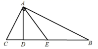

# Mathematics - 题目 715

**ID**: f8f89e3682c44fbca3fccaa0d8623130
**年级**: Grade 9
**难度**: Medium
**题型**: Multiple-choice

## 题目
如图，在 $Rt\Delta ABC$ 中， $\angle BAC=90{}^\circ $ ， $AD\bot BC$ ，垂足为 $D$ ， $E$ 是点 $BC$ 的中点， $AD=ED=4$ ，则 $BC$ 的长为（      ）​​​​​​​‌

## 解答

1. 解： $AD\bot BC$ ，
2. ∴ $\angle ADE=90{}^\circ $  ，
3. ∴ $AE{^{2}}=AD{^{2}}+DE{^{2}}$  （勾股定理），
4. ∴ $AE=\sqrt {AD{^{2}}+DE{^{2}}}=\sqrt {4{^{2}}+4{^{2}}}=4\sqrt {2}$  ,
5. 又∵ $\angle BAC=90{}^\circ $ ， $E$ 是点 $BC$ 的中点，
6. ∴ $AE=\frac {1}{2}BC$  （直角三角形斜边上的中线等于斜边的一半），
7. ∴ $BC=2AE=2\times 4\sqrt {2}=8\sqrt {2}$  ，
8. 故选：D．

## 知识点

**中文**:
  - 勾股定理的应用
  - 直角三角形斜边上的中线

**English**:
  - Applications of Pythagorean Theorem
  - Median to Hypotenuse of Right Triangle

---
