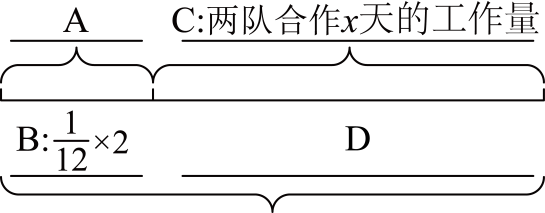

# Mathematics - 题目 1285

**ID**: fa638698f5d6442b868048af8bbea8cb
**年级**: Grade 9
**难度**: Medium
**题型**: Multiple-choice

## 题目
一道条件缺失的问题情境：一项工程，甲队单独做需要 $12$ 天完成， $\cdots $ ，还需要几天完成任务． 根据标准答案，老师在黑板上画出线段示意图，设两队合作还需 $x$ 天完成任务，并列方程为  $\frac {1}{12}\times 2+\left ({\frac {1}{8}+\frac {1}{12}}\right )x=1$ 根据上面信息，下面结论不正确的是（      ）​​​​​​​‌

## 解答

1. 解：由图可知：点乙队单独完成需要 $8$ 天完成，故 ${\rm{A}}$ 说法正确，不符合题意；
2. ${\rm{A}}$ 处代表的实际意义：甲先做 $2$ 天的工作量，故 ${\rm{C}}$ 说法正确，不符合题意；
3. ${\rm{D}}$ 处代表的代数式  $\left ({\frac {1}{8}+\frac {1}{12}}\right )x$ ，故 ${\rm{B}}$ 说法正确，不符合题意；
4. 由 $\frac {1}{12}\times 2+\left ({\frac {1}{8}+\frac {1}{12}}\right )x=1$ ，解得 $x=4$ ，甲乙两队再合作 $4$ 天完成了整个工程，故 ${\rm{D}}$ 说法不正确，符合题意；
5. 故此题答案为 ${\rm{D}}$ ．

## 知识点

**中文**:
  - 工程问题
  - 解一元一次方程

**English**:
  - Engineering Problems
  - Solving Procedures

---
