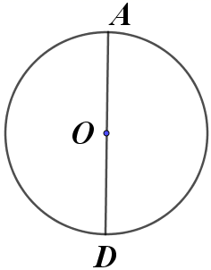

# Mathematics - 题目 3099

**ID**: fec885c03e214196a7aa0c5675f6af8c
**年级**: Grade 9
**难度**: Medium
**题型**: Multiple-choice

## 题目
如图， $AD$ 为 $\odot O$ 直径，作 $\odot O$ 的内接正六边形，甲、乙两人的作法分别如下：甲：1．作 $OA$ 的中垂线，交圆 $O$ 于 $B,F$ 两点；​​​​​​​‌2．作 $OD$ 的中垂线，交圆 $O$ 于 $C,E$ 两点；3．顺次连接 $A,B,C,D,E,F$ 六个点，六边形即为所求；乙：1．以 $A$ 为圆心， $OA$ 长为半径作弧，交圆 $O$ 于 $B,F$ 两点；2．以 $D$ 为圆心， $OA$ 长为半径作弧，交圆 $O$ 于 $C,E$ 两点；3．顺次连接 $A,B,C,D,E,F$ 六个点，六边形即为所求；对于甲、乙两人的作法，可判断（      ）

## 解答

1. 甲：
2. ∵BF是中垂线
3. ∴四边形OCDE是菱形
4. ∴△OCD, △OED都是等边三角形，
5. 同理可得△OAB, △OAF也是等边三角形
6. ∴∠BOC=∠EOF=60°
7. ∴△OBC, △OEF也是等边三角形
8. ∴内接六边形各边相等，各角相等都是120°
9. ∴圆内接六边形ABCDEF是正六边形
10. 乙：
11. ∵AB=AO=BO=AF=OF
12. ∴△OAB, △OAF都是等边三角形，
13. 同理可得△OCD, △OED也是等边三角形
14. ∴∠BOC=∠EOF=60°
15. ∴△OBC, △OEF也是等边三角形
16. ∴内接六边形各边相等，各角相等都是120°
17. ∴圆内接六边形ABCDEF是正六边形
18. 故选D

## 知识点

**中文**:
  - 尺规作图——正多边形
  - 正多边形和圆

**English**:
  - Construction: Regular Polygons
  - Regular Polygons and Circles

---
