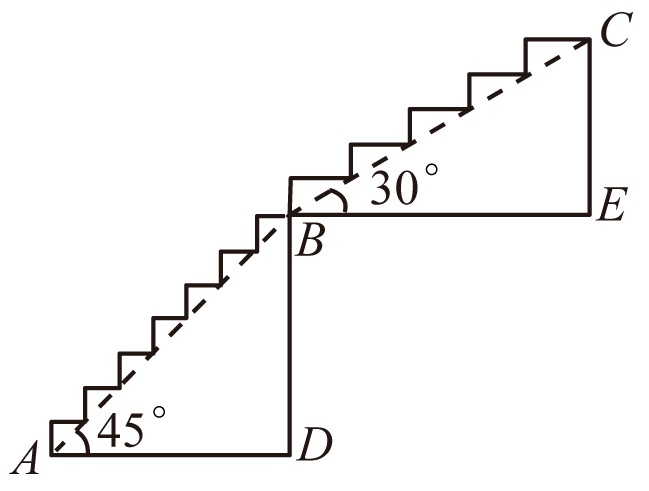

# Mathematics - 题目 2412

**ID**: 4364a60b38cd40e38a3d2adedbd2476c
**年级**: Grade 9
**难度**: Medium
**题型**: 1.3

## 题目
某阶梯的形状如图所示，其中线段 $AB=BC$ ， $AB$ 部分的坡角为 $45{}^\circ $ ， $BC$ 部分的坡角为 $30{}^\circ $ ， $AD=1.​​​​​​​‌5{\rm{m}}$ ．如果每个台阶的高不超过 $20{\rm{c}}{\rm{m}}$ ，那么这一阶梯至少有多少个台阶？（最后一个台阶的高不足 $20{\rm{c}}{\rm{m}}$ 时，按一个台阶计算）

## 解答

1. 解：∵AB部分的坡角为45°，AD＝1.5m，
2. ∴BD＝AD＝1.5m，
3. ∴AB＝ $\frac {3}{2}\sqrt {2}$  m，
4. ∵AB＝BC，
5. ∴BC＝ $\frac {3}{2}\sqrt {2}$  m，
6. ∵BC部分的坡角为30°，
7. ∴EC＝ $\frac {1}{2}$BC＝ $\frac {3\sqrt {2}}{4}$ m，
8. ∴BD＋CE＝ $\frac {3}{2}{{+}}\frac {3\sqrt {2}}{4}$ （m），
9. ∵每个台阶的高不超过20cm，
10. ∴至少有台阶的数量为（ $\frac {3}{2}{{+}}\frac {3\sqrt {2}}{4}$ ）×100÷20≈13．

## 知识点

**中文**:
  - 特殊角的三角函数值

**English**:
  - Trigonometric Values of Special Angles

---
