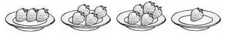

# Mathematics (Grade 1)

**ID**: 1196ad04
**难度**: hard
**题型**: fill_in_the_blank

## 题目

1.一共有（）盘草莓。（yí gòng yǒu （）pán cǎo méi 。）
2.从左边数，第（）盘和第3盘合起来是6颗草莓。（cóng zuǒ biān shǔ ，dì （）pán hé dì 3 pán hé qǐ lái shì 6 kē cǎo méi 。）
3.从左边数，第2盘和第（）盘合起来是7颗草莓。（cóng zuǒ biān shǔ ，dì 2 pán hé dì （）pán hé qǐ lái shì 7 kē cǎo méi 。）
4.从右边数，第1盘和第2盘合起来是（）颗草莓。（cóng yòu biān shǔ ，dì 1 pán hé dì 2 pán hé qǐ lái shì （）kē cǎo méi 。）

## 解答

**答案**: 4, 4, 1, 6

1. Step1:数出图中草莓的盘数，可知一共有4盘草莓，对应第1题答案为4
2. Step2:从左边数，第3盘有5个草莓，因为6 - 5 = 1，数出盘子里是1个草莓的是从左边数第4盘，所以第2题答案为4
3. Step3:从左边数，第2盘有4个草莓，由于7 - 4 = 3，数出盘子里是3个草莓的是从左边数第1盘，所以第3题答案为1
4. Step4:从右边数，第1盘里有1个草莓，第2盘里有5个草莓，1 + 5 = 6，所以第4题答案为6

## 知识点

**知识点**:
  - 10以内数的认识

---
