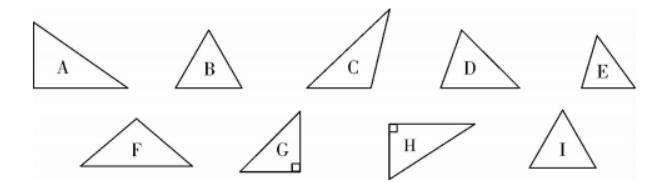

# Mathematics (Grade 1)

**ID**: 4d1e1b62
**难度**: hard
**题型**: fill_in_the_blank

## 题目
给三角形分类。（把字母填在相应的圈里）

直角三角形
 $\underline{\hspace{5em}}$  
锐角三角形
 $\underline{\hspace{5em}}$  
钝角三角形
 $\underline{\hspace{5em}}$  
等边三角形
 $\underline{\hspace{5em}}$

## 解答

**答案**: A、G、H, B、D、E、I, C、F, B、I

1. Step1:根据有一个角是直角的三角形是直角三角形的概念，观察图形找出直角三角形为A、G、H
2. Step2:依据三个角都是锐角的三角形是锐角三角形的概念，观察图形确定锐角三角形是B、D、E、I
3. Step3:按照有一个角是钝角的三角形是钝角三角形的概念，观察图形得到钝角三角形是C、F
4. Step4:根据三条边都相等的三角形是等边三角形的概念，观察图形找出等边三角形是B、I

## 知识点

**知识点**:
  - 三角形的分类

---
