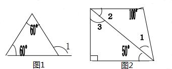

# Mathematics (Grade 1)

**ID**: 526fdc38
**难度**: hard
**题型**: fill_in_the_blank

## 题目
求如图图形中未知角的度数．

（1）如图1：∠1= $\underline{\hspace{5em}}$ ° 
（2）如图2：∠1= $\underline{\hspace{5em}}$ °，∠2= $\underline{\hspace{5em}}$ °，∠3= $\underline{\hspace{5em}}$ °．

## 解答

**答案**: 120, 30, 50, 40

1. Step1:计算图1中三角形第三个内角的度数，180 - 60 - 60 = 60°
2. Step2:计算图1中∠1的度数，180 - 60 = 120°
3. Step3:计算图2中∠3的度数，180 - 90 - 50 = 40°
4. Step4:计算图2中∠2的度数，90 - 40 = 50°
5. Step5:计算图2中∠1的度数，180 - 50 - 100 = 30°

## 知识点

**知识点**:
  - 三角形的内角和

---
