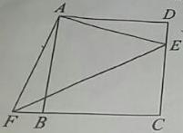

# Mathematics (Grade 1)

**ID**: 5fd7580e
**难度**: hard
**题型**: fill_in_the_blank

## 题目
如图，边长为4cm的正方形ABC中，点E在CD边上，且DE=1cm，△
ABF是由△
ADE旋转得到的．
 (1)△
ABF是由△
ADE绕点______，______(填“顺”或“逆”)时针旋转______°得到的．
 (2)求AF和EF的长．

## 解答

**答案**: A, 顺, 90, sqrt(17), sqrt(34)

1. Step1:观察图形，确定△ABF是由△ADE绕点A顺时针旋转90°
2. Step2:在正方形ABCD中，已知AD = 4cm，DE = 1cm，在Rt△ADE中，根据勾股定理AE = sqrt(AD**2 + DE**2) = sqrt(4**2 + 1**2) = sqrt(17)cm
3. Step3:因为△ABF是由△ADE旋转得到的，所以△ABF≌△ADE，得出AF = AE = sqrt(17)cm
4. Step4:由△ABF≌△ADE，可得BF = DE = 1cm，计算EC = 4 - 1 = 3cm，FC = 4 + 1 = 5cm
5. Step5:在Rt△ECF中，根据勾股定理EF = sqrt(EC**2 + FC**2) = sqrt(3**2 + 5**2) = sqrt(34)cm

## 知识点

**知识点**:
  - --

---
