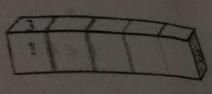

# Mathematics (Grade 1)

**ID**: c2b275e2
**难度**: hard
**题型**: fill_in_the_blank

## 题目
图中每个正方体的六个面分别写着3～8这六个数字，并且任意两个相对的面上所写的数字之和都等于11，把这样的五个正方体连在一起，紧挨着的两上面上的数字之和都等于12．图中打“？”的一组对面上所写的数字是多少？

 3
 3
 ？

## 解答

**答案**: 5, 6

1. Step1:根据任意两个相对的面上所写的数字之和都等于11，因为最后一个正方体的右面数字是3，所以其对面数字为11 - 3 = 8
2. Step2:依据紧挨着的两个面上的数字之和都等于12，可得第二个正方体右面数字是12 - 8 = 4，再根据相对面数字和为11，可知其对面数字是11 - 4 = 7
3. Step3:同理，可推出第一个正方体右面为7，其相对面数字为11 - 7 = 4
4. Step4:由于每个正方体六个面是3 - 8这六个数字，已经确定了部分面的数字，剩下数字组合中，满足相对面数字和为11的只有5和6，所以打‘？’的一组对面上所写的数字是5和6

## 知识点

**知识点**:
  - --

---
