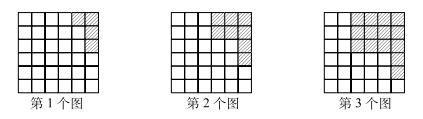

# Mathematics (Grade 1)

**ID**: c530d497
**难度**: hard
**题型**: fill_in_the_blank

## 题目
（1）下图是正方形网格中按规律填成的阴影，根据此规律，则第n个图中阴影部分小正方形的个数是 $\underline{\hspace{5em}}$ 。

（2）$\frac{10}{50}$在数列$\frac{1}{1}$，$\frac{1}{2}$，$\frac{2}{2}$，$\frac{1}{3}$，$\frac{2}{3}$，$\frac{3}{3}$，$\frac{1}{4}$，$\frac{2}{4}$，$\frac{3}{4}$，…中排在第 $\underline{\hspace{5em}}$ 位。

## 解答

**答案**: n**2+n+2, 1235

1. Step1:分析第（1）题，发现每个图阴影部分可分割为正方形与长方形中正方形个数的和，其中正方形个数是顺序号的平方，即n**2，长方形中正方形个数是顺序号加上2，即n + 2，所以第n个图中阴影部分小正方形个数为n**2 + n + 2
2. Step2:分析第（2）题，先计算分母小于50时数列中数的个数，根据等差数列求和公式(首项+末项)*项数/2，即(1 + 49)*49/2 = 1225
3. Step3:确定分母为50的数中，\(rac{10}{50}\)是第10个
4. Step4:得出\(rac{10}{50}\)在数列中的排位为1225 + 10 = 1235

## 知识点

**知识点**:
  - 图形中的规律;数列中的规律

---
