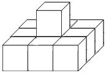

# Mathematics (Grade 1)

**ID**: f368218d
**难度**: hard
**题型**: fill_in_the_blank

## 题目
如图是由若干个小正方体拼成的，如果把它的表面都涂上蓝色，则这些小正方体中，有1个面被涂成蓝色的有$\underline{\hspace{5em}}$      个，有3个面被涂成蓝色的有$\underline{\hspace{5em}}$      个，有4个面被涂成蓝色的有$\underline{\hspace{5em}}$      个，有5个面被涂成蓝色的有$\underline{\hspace{5em}}$      个．

## 解答

**答案**: 1, 4, 4, 1

1. Step1:分析1个面被涂成蓝色的小正方体位置，可知在下层正中间，数量为1个
2. Step2:分析3个面被涂成蓝色的小正方体位置，在下层4条棱的中间，数量为4个
3. Step3:分析4个面被涂成蓝色的小正方体位置，在下层4个角上，数量为4个
4. Step4:分析5个面被涂成蓝色的小正方体位置，在最上层，数量为1个

## 知识点

**知识点**:
  - 染色问题

---
