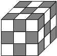

# Mathematics (Grade 1)

**ID**: c590cfac
**难度**: hard
**题型**: multiple_choice

## 题目

(2014•上海模拟)将27个大小相同的小正方体组成一个大正方体，现将大正方体各个面上的某些小方格涂上黑色(见图)，而且上与下、前与后、左与右相对两个面上的涂色方式相同，这时至少有一个面上涂有黑色的小正方体的个数是(  )
A．18
B．20
C．22
D．24

## 解答

**答案**: B

1. Step1:明确大正方体由27个小正方体组成且相对面涂色方式相同
2. Step2:确定第一层至少有一个面上涂有黑色的小正方体个数为7个
3. Step3:确定第二层至少有一个面上涂有黑色的小正方体个数为6个
4. Step4:确定第三层至少有一个面上涂有黑色的小正方体个数为7个
5. Step5:将三层至少有一个面上涂有黑色的小正方体个数相加，即7 + 6 + 7 = 20个
6. Step6:根据计算结果，从选项中选择答案B

## 知识点

**知识点**:
  - 染色问题．

---
