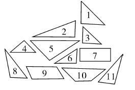

# Mathematics (Grade 1)

**ID**: 7267d6dc
**难度**: hard
**题型**: short_answer

## 题目
观察下列图形，按要求给图形分类。

（1）有几个锐角三角形？
（2）有几个钝角三角形？
（3）有几个直角三角形？

## 解答

**答案**: 0, 3, 4

1. Step1:根据锐角三角形定义，三个角都是锐角的三角形是锐角三角形，观察图形，发现没有符合该特征的三角形，所以锐角三角形个数为0
2. Step2:依据钝角三角形定义，有一个角是钝角的三角形是钝角三角形，观察可得图形5、8和11是钝角三角形，因此钝角三角形个数为3
3. Step3:按照直角三角形定义，有一个角是直角的三角形是直角三角形，经观察图形1、2、3和6是直角三角形，故直角三角形个数为4

## 知识点

**知识点**:
  - 三角形的分类

---
