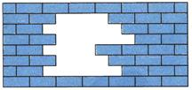

# Mathematics (Grade 1)

**ID**: 117b7ec5
**难度**: medium_easy
**题型**: fill_in_the_blank

## 题目
下面的墙缺了（____）块砖。

## 解答

**答案**: 15

1. Step1:观察墙面，发现每行砖的数量是固定的，均为5块。
2. Step2:从上往下看，第一行缺1块砖；第二行缺3块砖；第三行缺3块砖；第四行缺2块砖；第五行缺3块砖；第六行缺3块砖。
3. Step3:将每行缺的砖数相加，即1 + 3 + 3 + 2 + 3 + 3 = 15块。

## 知识点

**知识点**:
  - 小学数学;图形与几何;平面图形;平面图形的认识及分类

---
