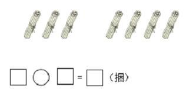

# Mathematics (Grade 1)

**ID**: 1d1af15f
**难度**: medium_easy
**题型**: fill_in_the_blank

## 题目
看图列式

## 解答

**答案**: 3+4=7

1. Step1:观察图片，左边有3捆小棒
2. Step2:观察图片，右边有4捆小棒
3. Step3:要求小棒的总数，需将左右两边小棒数量相加
4. Step4:左边3捆加上右边4捆，列式为3+4
5. Step5:计算得出3+4=7

## 知识点

**知识点**:
  - 小学数学;数与代数;应用题;常见的数学问题;图文问题

---
