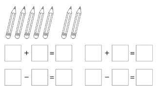

# Mathematics (Grade 1)

**ID**: 3f631c7b
**难度**: medium_easy
**题型**: fill_in_the_blank

## 题目
我会列式。

## 解答

**答案**: 5+2=7, 2+5=7, 7-2=5, 7-5=2

1. Step1:观察图片可知，左边有5支铅笔，右边有2支铅笔
2. Step2:根据加法的意义，将左右两边铅笔的数量相加，可得到加法算式5 + 2 = 7
3. Step3:交换加数的位置，得到另一个加法算式2 + 5 = 7
4. Step4:根据加法算式的结果7，以及其中一个加数2，利用减法的意义，可得到减法算式7 - 2 = 5
5. Step5:根据加法算式的结果7，以及其中一个加数5，利用减法的意义，可得到减法算式7 - 5 = 2

## 知识点

**知识点**:
  - 小学数学;数与代数;应用题;常见的数学问题;图文问题

---
