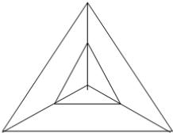

# Mathematics (Grade 1)

**ID**: 5395c055
**难度**: medium_easy
**题型**: fill_in_the_blank

## 题目
图中共有(    )个三角形．

## 解答

**答案**: 8

1. Step1:确定单个小块的三角形数量，有3个
2. Step2:确定由两小块拼成的三角形数量，有3个
3. Step3:确定由三小块拼成的三角形数量，有1个
4. Step4:确定由六小块拼成的三角形数量，有1个
5. Step5:将上述不同情况的三角形数量相加，即3+3+1+1=8个

## 知识点

**知识点**:
  - 组合图形的计数．

---
