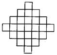

# Mathematics (Grade 1)

**ID**: 757e50bc
**难度**: medium_easy
**题型**: fill_in_the_blank

## 题目
数出右图有 $\underline{\hspace{5em}}$ 个正方形．

## 解答

**答案**: 42

1. Step1:数出由1个小正方形组成的正方形个数为24个。
2. Step2:数出由4个小正方形组成的正方形个数为13个。
3. Step3:数出由9个小正方形组成的正方形个数为4个。
4. Step4:数出由16个小正方形组成的正方形个数为1个。
5. Step5:将各类正方形个数相加，24 + 13 + 4 + 1 = 42个。

## 知识点

**知识点**:
  - 

---
