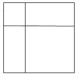

# Mathematics (Grade 1)

**ID**: 9d641532
**难度**: medium_easy
**题型**: fill_in_the_blank

## 题目
观察图形，填一填。

大正方形被分割后（包含复合图形）一共有________个长方形，一共有________个正方形。

## 解答

**答案**: 6, 3

1. Step1:先数长方形，单个的小长方形有2个，由两个小长方形组成的长方形有4个，所以长方形总数为2 + 4 = 6个
2. Step2:再数正方形，单个的小正方形有2个，由四个小正方形组成的大正方形有1个，所以正方形总数为2 + 1 = 3个

## 知识点

**知识点**:
  - 小学数学;图形与几何;平面图形;平面图形的认识及分类

---
