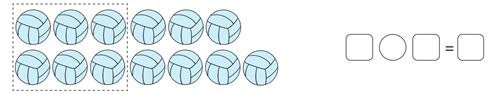

# Mathematics (Grade 1)

**ID**: a22d9a47
**难度**: medium_easy
**题型**: fill_in_the_blank

## 题目
看图列式计算。

## 解答

**答案**: 13-6=7

1. Step1:观察图片可知，图中一共有13个排球，圈起来的有6个
2. Step2:问题是求没圈起来的排球数量
3. Step3:根据减法的意义，已知总数和其中一部分，求另一部分用减法计算
4. Step4:所以用总数13减去圈起来的6个，列式为13 - 6
5. Step5:计算13 - 6的结果为7，即13 - 6 = 7

## 知识点

**知识点**:
  - 小学数学;数与代数;应用题;常见的数学问题;图文问题

---
