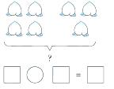

# Mathematics (Grade 1)

**ID**: a402abbb
**难度**: medium_easy
**题型**: fill_in_the_blank

## 题目
看图列式计算。

## 解答

**答案**: 4＋3＝7

1. Step1:观察图片可知，左边有4只鸭子，右边有3只鸭子
2. Step2:要求鸭子的总数，需将左右两边鸭子的数量相加
3. Step3:所以可列出算式4＋3
4. Step4:计算4＋3的结果为7，完整算式为4＋3＝7

## 知识点

**知识点**:
  - 小学数学;数与代数;应用题;常见的数学问题;图文问题

---
