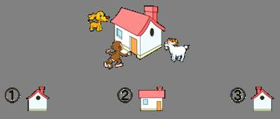

# Mathematics (Grade 1)

**ID**: bc5276a8
**难度**: medium_easy
**题型**: fill_in_the_blank

## 题目
根据下图，填序号。

小狗看到的是图________
小猴看到的是图________
小羊看到的是图________

## 解答

**答案**: ③, ②, ①

1. Step1:观察图片可知小狗在房子的后面，从后面看房子烟囱在左边，所以小狗看到的是图③
2. Step2:观察图片可知小猴在房子的侧面，从侧面看房子窗户是长方形且在右边，所以小猴看到的是图②
3. Step3:观察图片可知小羊在房子的正面，从正面看房子门在中间，所以小羊看到的是图①

## 知识点

**知识点**:
  - 小学数学;图形与几何;立体图形;观察物体

---
