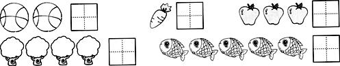

# Mathematics (Grade 1)

**ID**: e4244c17
**难度**: medium_easy
**题型**: fill_in_the_blank

## 题目
数一数，写一写。      

## 解答

**答案**: 2, 1, 3, 4, 5

1. Step1:数篮球的数量，得出有2个，对应答案第一个数2
2. Step2:数胡萝卜的数量，得出有1个，对应答案第二个数1
3. Step3:数苹果的数量，得出有3个，对应答案第三个数3
4. Step4:数小树的数量，得出有4棵，对应答案第四个数4
5. Step5:数小鱼的数量，得出有5条，对应答案第五个数5

## 知识点

**知识点**:
  - 

---
