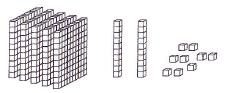

# Mathematics (Grade 1)

**ID**: e6386d4e
**难度**: medium_easy
**题型**: fill_in_the_blank

## 题目

有（  ）个百，（ ）个十，（  ）个一，他们组成的数是（  ）。

## 解答

**答案**: 5, 2, 9, 529

1. Step1:观察图片，数出图中由小正方体组成的大长方体的数量，每个大长方体代表100，得出有5个百
2. Step2:数出图中由小正方体组成的长条的数量，每个长条代表10，得出有2个十
3. Step3:数出单独的小正方体的数量，每个小正方体代表1，得出有9个一
4. Step4:将百位、十位、个位上的数字组合起来，得到组成的数是529

## 知识点

**知识点**:
  - 

---
