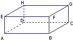

# Mathematics (Grade 1)

**ID**: c6f8c7a2
**难度**: medium_easy
**题型**: multiple_choice

## 题目
如图，在长方体ABCD-EFGH中，与棱CD平行的平面有(    )个．

## 解答

**答案**: 2

1. Step1:明确长方体中面与棱的位置关系，判断与棱CD相交的面，有下面ABCD、后面ADHE、左面BCGF、右面EFGH四个面。
2. Step2:找出长方体中除了与棱CD相交的面之外的面，即上面ABFE和前面EFGH。
3. Step3:得出与棱CD平行的平面是上面ABFE和前面EFGH，共2个。

## 知识点

**知识点**:
  - 平面图形的分类及识别．

---
