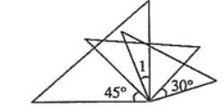

# Mathematics (Grade 1)

**ID**: 3dcddc19
**难度**: medium_easy
**题型**: short_answer

## 题目
三个直角三角形叠放在一起，如下图所示，求∠1的度数。

## 解答

**答案**: 15°

1. Step1:观察图形可知，与∠1相关的两个角分别为45°和30°
2. Step2:根据角的关系，∠1的度数等于45°角与30°角的差
3. Step3:计算45° - 30° = 15°，得出∠1的度数为15°

## 知识点

**知识点**:
  - 三角形;三角形的内角和

---
