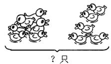

# Mathematics (Grade 1)

**ID**: 92e4a18f
**难度**: medium_easy
**题型**: short_answer

## 题目
看图列式计算：

## 解答

**答案**: 11

1. Step1:观察图片可知，左边有6只鸭子，右边有5只鸭子
2. Step2:要求鸭子的总数，需将左右两边鸭子的数量相加
3. Step3:通过计算6 + 5 = 11，得出鸭子总数为11只

## 知识点

**知识点**:
  - 小学数学;数与代数;应用题;常见的数学问题;图文问题

---
