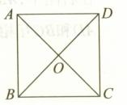

# Mathematics (Grade 1)

**ID**: 0130cf31
**难度**: medium
**题型**: fill_in_the_blank

## 题目
观察下图，写出相交或垂直的线段。（至少写两组）

## 解答

**答案**: AB⊥BC, AD⊥DC

1. Step1:根据垂直的定义，两条直线相交，组成的角是直角，这两条直线互相垂直。
2. Step2:观察图形可知其为正方形，而正方形的四个角是直角。
3. Step3:因为正方形四个角是直角，所以其四条边两两垂直，由此可得AB⊥BC。
4. Step4:同理，根据正方形四条边两两垂直，可得AD⊥DC。

## 知识点

**知识点**:
  - 相交与垂直

---
