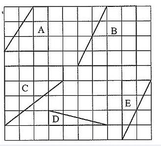

# Mathematics (Grade 1)

**ID**: 06169637
**难度**: medium
**题型**: fill_in_the_blank

## 题目
如图，网格中有五个图形，（  ）和（  ）能拼成一个正方形。

## 解答

**答案**: B, E

1. Step1:明确目标是从五个图形A、B、C、D、E中找出能拼成一个正方形的两个图形
2. Step2:观察图形的形状和大小，判断哪些图形组合可能拼成正方形
3. Step3:发现图形B和图形E的形状和大小能够匹配，拼合后可以组成一个正方形

## 知识点

**知识点**:
  - 图形与几何

---
