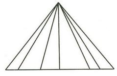

# Mathematics (Grade 1)

**ID**: 14b65988
**难度**: medium
**题型**: fill_in_the_blank

## 题目
图中有(   )个三角形 .

## 解答

**答案**: 21

1. Step1:明确三角形的定义，即由不在同一直线上的三条线段首尾顺次连接所组成的封闭图形叫做三角形
2. Step2:从图中最小的单个三角形开始数，有5个
3. Step3:由两个相邻的小三角形组成的三角形有4个
4. Step4:由三个相邻的小三角形组成的三角形有3个
5. Step5:由四个相邻的小三角形组成的三角形有2个
6. Step6:由五个小三角形组成的大三角形有1个
7. Step7:将上述不同组合方式的三角形个数相加，5 + 4 + 3 + 2 + 1 = 21个

## 知识点

**知识点**:
  - 三角形
--

---
