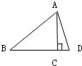

# Mathematics (Grade 1)

**ID**: 3e0f5b1c
**难度**: medium
**题型**: fill_in_the_blank

## 题目
如图，在AB、AC、AD这三条线段中，最短的是______．

## 解答

**答案**: AC

1. Step1:观察图形可知在三角形ABD中存在线段AB、AC、AD
2. Step2:发现线段AC是从点A向BD作的垂线段
3. Step3:根据垂线段最短的性质，得出在AB、AC、AD这三条线段中，AC最短

## 知识点

**知识点**:
  - 两点间线段最短与两点间的距离．

---
