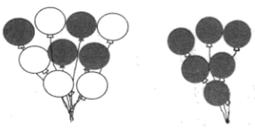

# Mathematics (Grade 1)

**ID**: 49c4c2a5
**难度**: medium
**题型**: fill_in_the_blank

## 题目
一共有15个气球。
（1）左边有9个气球，右边有几个？

□○□＝□（  ）
（2）黑色气球有10个，白色气球有几个？
□○□＝□（  ）

## 解答

**答案**: 6, 5

1. Step1:已知一共有15个气球，左边有9个气球，求右边气球个数，用总数减去左边的数量，即15 - 9 = 6个
2. Step2:已知一共有15个气球，黑色气球有10个，求白色气球个数，用总数减去黑色气球的数量，即15 - 10 = 5个

## 知识点

**知识点**:
  - 小学数学;数与代数;应用题;简单应用题;整数简单应用题

---
