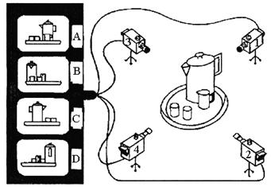

# Mathematics (Grade 1)

**ID**: 63220e99
**难度**: medium
**题型**: fill_in_the_blank

## 题目
如下图所示，电视台的摄像机1、2、3、4在不同位置拍摄了四幅画面，则A图像是________号摄像机所拍，B图像是________号摄像机所拍，C图像是________号摄像机所拍，D图像是________号摄像机所拍．

## 解答

**答案**: 2, 4, 3, 1

1. Step1:观察图片，确定A图像的视角特征，从图中可知A图像的视角对应2号摄像机的位置，所以A图像是2号摄像机所拍
2. Step2:观察B图像的视角特征，根据画面视角判断其对应4号摄像机的位置，所以B图像是4号摄像机所拍
3. Step3:观察C图像的视角特征，依据视角可确定其由3号摄像机拍摄，所以C图像是3号摄像机所拍
4. Step4:观察D图像的视角特征，通过视角得出其是1号摄像机所拍，所以D图像是1号摄像机所拍

## 知识点

**知识点**:
  - 小学数学;图形与几何;立体图形;观察物体

---
