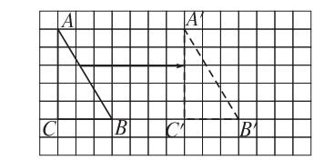

# Mathematics (Grade 1)

**ID**: 669557c4
**难度**: medium
**题型**: fill_in_the_blank

## 题目
下图中的三角形向右平移了7格，请你写出平移前后互相平行的线段。

## 解答

**答案**: AC和A′C′平行, AB和A′B′平行

1. Step1:明确本题考查图形平移和平行的概念
2. Step2:根据图形平移的性质，可知平移后图形的形状、大小不变，只是位置发生变化
3. Step3:依据平移前后三角形对应边平行这一性质
4. Step4:找出三角形ABC平移后对应的三角形A'B'C'的对应边，即AC与A′C′，AB与A′B′
5. Step5:得出AC和A′C′平行，AB和A′B′平行

## 知识点

**知识点**:
  - 平行;认识平移与旋转现象

---
