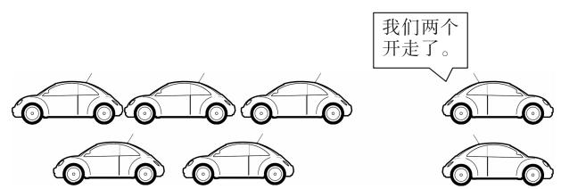

# Mathematics (Grade 1)

**ID**: 6b77ddc1
**难度**: medium
**题型**: fill_in_the_blank

## 题目
还剩下几辆车？

□○□=□

## 解答

**答案**: 5

1. Step1:明确题目是求剩余车辆数
2. Step2:根据题意可知原来有7辆车
3. Step3:确定开走了2辆车
4. Step4:根据减法的意义，用原来车的数量7减去开走的数量2，即7 - 2
5. Step5:计算7 - 2的结果为5，得出剩下5辆车

## 知识点

**知识点**:
  - 10以内数的加减法

---
