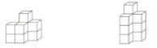

# Mathematics (Grade 1)

**ID**: 8d7a3211
**难度**: medium
**题型**: fill_in_the_blank

## 题目
下面两个物体中至少各有多少个小正方体？

 （  ）个    （  ）个

## 解答

**答案**: 9, 10

1. Step1:观察第一个物体，数出其至少含有的小正方体个数为9
2. Step2:观察第二个物体，数出其至少含有的小正方体个数为10

## 知识点

**知识点**:
  - 观察物体;

---
