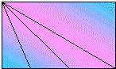

# Mathematics (Grade 1)

**ID**: a91bf956
**难度**: medium
**题型**: fill_in_the_blank

## 题目
数一数图中共有几个三角形？  

## 解答

**答案**: 7

1. Step1:数出图中单个的三角形，数量为4个
2. Step2:数出由两个三角形合成的三角形，数量为2个
3. Step3:数出由3个小三角形组成的大三角形，数量为1个
4. Step4:将上述三种三角形的数量相加，即4 + 2 + 1 = 7个

## 知识点

**知识点**:
  - 组合图形的计数．

---
