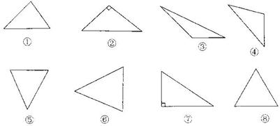

# Mathematics (Grade 1)

**ID**: b4f01b2b
**难度**: medium
**题型**: fill_in_the_blank

## 题目
把图形的序号填在相应的横线上．

锐角三角形有(    )；直角三角形有(    )；钝角三角形有(    )；等腰三角形有(    )；等边三角形有(    )．

## 解答

**答案**: ①、⑤、⑥、⑧, ②、⑦, ③、④, ⑥、⑦、⑧, ⑤、⑧

1. Step1:根据三个角都是锐角的三角形叫做锐角三角形，从图中找出①、⑤、⑥、⑧符合此特征，所以锐角三角形有①、⑤、⑥、⑧
2. Step2:依据有一个角是直角的三角形叫做直角三角形，确定图中②、⑦是直角三角形
3. Step3:按照有一个角是钝角的三角形是钝角三角形，得出③、④为钝角三角形
4. Step4:根据两边相等的三角形是等腰三角形，可知⑤、⑥、⑧是等腰三角形
5. Step5:由三边都相等的是等边三角形，得到⑤、⑧是等边三角形

## 知识点

**知识点**:
  - 三角形的分类．

---
