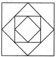

# Mathematics (Grade 1)

**ID**: c1d5d0ec
**难度**: medium
**题型**: fill_in_the_blank

## 题目
数一数．图中有$\underline{\hspace{5em}}$个正方形．

## 解答

**答案**: 4

1. Step1:观察图形，确定从内到外的结构
2. Step2:发现从内到外都是单个的正方形
3. Step3:数出单个正方形的数量为4个
4. Step4:明确没有组合的正方形
5. Step5:得出图中正方形的总数为4个

## 知识点

**知识点**:
  - 组合图形的计数．

---
